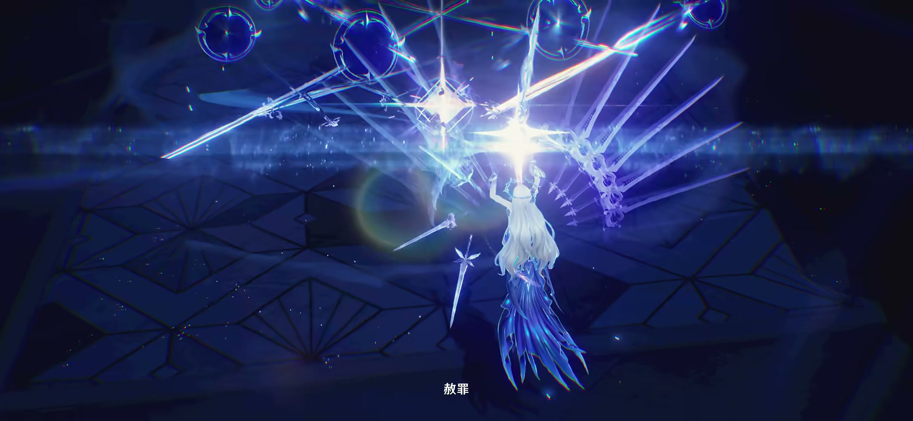

# 《鸣潮》版本产能拆解（1.0—3.7）

> 研究更新：2026-10-26（UTC+8）｜覆盖截至 3.7「镜锁妄世，心照红尘」的**正式上线**内容。 
> 目的：把版本更新中可比较的角色、剧情、地图、Boss、武器与声骸产出拆成可复核指标，而非评价角色强度或游戏质量。

## 结论先看

| 模块 | 截至 3.7 的可比结论 | 推荐作为产能指标 |
| --- | --- | --- |
| 角色 | 共 57 名角色条目（5 星 45、4 星 12）；开服后 21 个更新版本新增 40 名，平均 **1.90 名/版**；其中 37 名为 5 星 | 新角色数、5/4 星结构、特殊形态/新机制 |
| 剧情 | 已核实的全类型剧情录屏合计约 **99 小时 41 分**；覆盖 22 个版本、197 段录屏 | 逐版本剧情合计；韩国社区调查与海外个人评分分列 |
| 地图 | 新增永久区域/大型场景至少 15 次；官方**未公布可换算的 km² 面积** | 永久区域/子区数、探索机制、资源类型 |
| Boss | 常驻「全息战略」可挑战 Boss 共 **23 名**：强袭 6、幻痛 10、同步 5、演武 2 | 全息 Boss 数与新增节奏；不把普通敌人图鉴条目混入 |
| 武器与声骸 | Encore Release 快照：武器 124 把、合鸣效果 37 套；3.0—3.7 新增 21 把 5 星武器、16 套合鸣效果 | 新 5 星武器数、合鸣套数、声骸条目数（另列） |

## 0. 统计口径与置信度

1. **角色**：按版本内首次实装、可操作的共鸣者计数；复刻不计。漂泊者的新属性形态不算新角色，单列为“战斗模块迭代”。可唤取的 SP 角色“秧秧·玄翎”计为独立角色。
2. **剧情时长**：将同版已收录的主线、伴星、危行、纪闻、活动、联动、奇谭等录屏去重加总，代表内容体验时长（含移动、战斗和部分活动操作）。这是录屏样本的合计，尚未穷尽所有世界支线；录制节奏会影响结果，不能视作纯配音或 CG 时长。
3. **地图面积**：库洛未公开地图坐标比例或可换算面积，且游戏含分层、地下、独立场景。故本报告不填写虚假的 km²；用永久区域/子区与资源机制衡量地图产能。
4. **Boss**：以官方「全息战略」挑战池为核心；Encore 的怪物图鉴中“高阶敌人”条目含幻象、回想等变体，不能直接等同独立 Boss 数。
5. **数据源优先级**：库洛官网版本说明 > 官方渠道转帖/应用商店 > Encore Release 数据库 > B 站完整录屏与攻略。所有 B 站创作者统计均只作交叉参考。

---

## 1. 角色：数量、稀有度与模组复杂度

### 1.1 各版本首次实装角色

<section class="version-card">
<h4>1.x</h4>
<table>
<thead><tr><th>版本</th><th>5 星（数量）</th><th>4 星（数量）</th></tr></thead>
<tbody>
<tr><td>1.0</td><td>8</td><td>9</td></tr>
<tr><td>1.1</td><td>2</td><td>0</td></tr>
<tr><td>1.2</td><td>2</td><td>0</td></tr>
<tr><td>1.3</td><td>1</td><td>1</td></tr>
<tr><td>1.4</td><td>1</td><td>1</td></tr>
</tbody>
</table>
</section>
<section class="version-card">
<h4>2.x</h4>
<table>
<thead><tr><th>版本</th><th>5 星（数量）</th><th>4 星（数量）</th></tr></thead>
<tbody>
<tr><td>2.0</td><td>2</td><td>0</td></tr>
<tr><td>2.1</td><td>2</td><td>0</td></tr>
<tr><td>2.2</td><td>1</td><td>0</td></tr>
<tr><td>2.3</td><td>2</td><td>0</td></tr>
<tr><td>2.4</td><td>2</td><td>0</td></tr>
<tr><td>2.5</td><td>1</td><td>0</td></tr>
<tr><td>2.6</td><td>2</td><td>0</td></tr>
<tr><td>2.7</td><td>2</td><td>0</td></tr>
<tr><td>2.8</td><td>1</td><td>1</td></tr>
</tbody>
</table>
</section>
<section class="version-card">
<h4>3.x</h4>
<table>
<thead><tr><th>版本</th><th>5 星（数量）</th><th>4 星（数量）</th></tr></thead>
<tbody>
<tr><td>3.0</td><td>2</td><td>0</td></tr>
<tr><td>3.1</td><td>2</td><td>0</td></tr>
<tr><td>3.2</td><td>1</td><td>0</td></tr>
<tr><td>3.3</td><td>2</td><td>0</td></tr>
<tr><td>3.4</td><td>3</td><td>0</td></tr>
<tr><td>3.5</td><td>2</td><td>0</td></tr>
<tr><td>3.6</td><td>2</td><td>0</td></tr>
<tr><td>3.7</td><td>2</td><td>0</td></tr>
</tbody>
</table>
</section>

**复核结果：** 表内合计为 57 名（5 星 45、4 星 12）。排除 1.0 开服阵容后，1.1—3.7 的 21 个更新版本共新增 40 名，平均 **1.90 名/版**；其中 37 名为 5 星、3 名为 4 星，新增角色的 5 星占比为 **92.5%**。分阶段看：1.1—1.4 为 2.00 名/版，2.0—2.8 为 1.78 名/版，3.0—3.7 为 2.00 名/版。

#### 漂泊者：不计“新角色”、但应计为模组产能

| 版本 | 新形态 | 处理方式 |
| --- | --- | --- |
| 1.0 | 衍射、湮灭 | 开服/主线基础形态 |
| 2.2 | 气动 | 复用主角资产，但拥有一套独立属性与技能机制 |
| 3.5 | 导电 | 同上；应在“角色战斗模块迭代”中统计 |

### 1.2 典型技能模组：从基础框架到双形态

角色不应仅以“出一个新模型”衡量。标准角色至少涉及普攻、重击、空中攻击、闪避反击、共鸣技能、共鸣回路、共鸣解放、变奏/延奏，以及与声骸和队伍协奏系统的联调。

| 案例 | 关键结构 | 对制作产能的含义 | 参考拆解 |
| --- | --- | --- | --- |
| **今汐（1.1）** | 4 段普攻/重击/空中动作；常规 E「流光夕影」在条件满足后替换为强化 E「神霓飞芒」；强化状态与队友协同攻击、属性伤害积层相连；大招独立范围爆发；变奏为强化 E 提供前置条件 | 在通用六技能框架上增加“状态切换 + 队友积层 + 单次高倍率收束”。除动作和特效外，还要实现资源条、状态替换、队伍交互与爆发轴 | [B站机制解析](https://www.bilibili.com/video/BV1qT421a7Hf/)、[17173 输出轴说明](https://news.17173.com/z/mingchao/content/07192024/180118981.shtml) |

---

### 1.3 卡提希娅：双形态与动作模组专题

<figure>

<figcaption><strong>卡提希娅｜流浪骑士</strong>4 段地面普攻 · 剑影生成与回收 · 下落攻击</figcaption>
</figure>
<figure>

<figcaption><strong>芙露德莉斯｜显化形态</strong>5 段地面普攻 · 3 段空中攻击 · 决意终结</figcaption>
</figure>

<strong>2</strong>套形态战斗体系

<strong>9</strong>小卡战斗动作条目

<strong>16</strong>大卡战斗动作条目

<strong>1</strong>首次变身动作条目

**本轮拆解结论：两套形态战斗体系，按技能说明可拆成 26 个战斗动作条目（9 + 16 + 1）。** 每段连击和有独立输入/名称的招式各记一项；计数依据是 Encore 技能文本与官方战斗演示，属于本报告的可复算拆分。B 站检索找到了动作鉴赏与双形态测评，但没有找到能验证的“去重动画文件总数”；本轮没有解包客户端，因此 **26 不能表述为 26 个引擎动画资产或 26 套动作模组**。待机、移动、受击、转身、收刀、表情与剧情动画也未计入这 26 项。

#### 四张代表性动作图

<figure>

<figcaption><strong>01 · 小卡：剑影与地面动作</strong>可留场的剑影参与后续回收；动作与场景实体联动。官方演示 00:30。</figcaption>
</figure>
<figure>

<figcaption><strong>02 · 小卡：下落攻击与剑影回收</strong>空中启动、落地表现和回收剑影共同形成一个动作流程。官方演示 00:39.8。</figcaption>
</figure>
<figure>

<figcaption><strong>03 · 大卡：空中战斗与御剑演出</strong>变身后启用新的攻击体系；空中连段可与共鸣技能衔接。官方演示 00:57。</figcaption>
</figure>
<figure>

<figcaption><strong>04 · 大卡：终结解放</strong>「看潮怒风哮之刃」独立镜头、巨剑与直线斩击表现。官方演示 01:27.5。</figcaption>
</figure>

图片均为库洛官方 [《共鸣者战斗演示｜卡提希娅》](https://www.bilibili.com/video/BV1hKT2znE6L/) 的研究用节选，非二创设定图；上方形态图分别取自 00:13.5 和 00:52，点击可查看 1920 × 886 原图。画面用于展示动作风格；具体招式数量按下表的技能文本核算。

#### 26 个动作条目是怎样拆出来的

| 动作类别 | 卡提希娅形态 | 数量 | 芙露德莉斯形态 | 数量 |
| --- | --- | ---: | --- | ---: |
| 地面普攻 | 第 1、2、3、4 段 | 4 | 第 1、2、3、4、5 段 | 5 |
| 重击 | 重击 1 种（可空中施放） | 1 | 重击、强化重击 | 2 |
| 空中攻击 | 下落攻击，基础计 1 种 | 1 | 空中攻击第 1、2、3 段 | 3 |
| 上挑攻击 | — | 0 | 地面按跳跃触发的上挑攻击 | 1 |
| 闪避反击 | 小卡闪避反击 | 1 | 大卡闪避反击，可接普攻第 4 段 | 1 |
| 共鸣技能 E | 「此剑以人之名」 | 1 | 「此剑为潮浪之意」「凭风斩浪破敌」 | 2 |
| 变奏入场 | 「此剑，为潮水的过去」 | 1 | 「此剑，为自由的未来」 | 1 |
| 满决意终结技 | — | 0 | 「看潮怒风哮之刃」 | 1 |
| **各形态小计** | **4 + 1 + 1 + 0 + 1 + 1 + 1 + 0** | **9** | **5 + 2 + 3 + 1 + 1 + 2 + 1 + 1** | **16** |

另计首次变身「听骑士从心祈愿」 **1 项**，合计 **26 项**。首次变身含角色外观切换、镜头和状态进入；显化期间再次切换形态会调用已列入的小卡/大卡普攻第 2 段或空中攻击，故不重复增加动作数量。

**分支处理规则：** 小卡下落攻击依回收 0/1/2/3 种剑影出现不同的形态/伤害表现。上表将它合并为 1 个基础动作；若研究“技能表现分支”，可另外记录 3 个非零剑影条件分支，但不能据此认定新增了 3 段独立骨骼动画。同一招式的多次命中、地面/空中皆可释放、倍率变化也不自动扩增计数。延奏为队伍增益，不作为一段新的前台攻击计数。

#### 双形态具体增加了哪些制作量

| 层面 | 卡提希娅 | 芙露德莉斯 | 产能观察 |
| --- | --- | --- | --- |
| 角色外观 | 小卡体型、服装与持剑表现 | 大卡体型、长发与显化后的服装/剑影表现 | 两种可操作形态需要分别验证动作适配、布料/头发和穿模表现；实际骨架复用情况未解包确认 |
| 战斗动作 | 4 段普攻、重击、反击、下落、E 与变奏 | 5 段普攻、3 段空中攻击、重击分支、上挑、两段 E 与变奏 | 大卡的招式与空地衔接较丰富；不能只按共用的技能按钮数量估算 |
| 场景实体 | 普攻第 4 段生成神权剑影；重击/变奏生成异权剑影；E 生成人权剑影；下落时回收 | 剑影增益改变控制、风蚀结算与范围目标的效应层数同步 | 三种剑影既有画面表现，也有存在时间、回收与增益传递逻辑 |
| 状态与资源 | 共鸣能量达到条件后可首次变身；回收剑影取得三类增益 | 「显化」基础持续 12 秒；攻击积攒「决意」，120 点开启终结技 | 共鸣能量、显化计时、决意、剑影增益和风蚀层数共同决定技能分支 |
| 解放与恢复 | 首次变身后生命降至上限 50%；低于 50% 时不消耗生命 | 终结时清空决意、退出显化、回复 50% 生命上限，依据敌人风蚀层数放大伤害并清除层数 | 两个解放节点分别承担变身与收束，需要镜头、状态和伤害/治疗逻辑同步 |
| 探索能力 | 负责任务对话、带动作的场景交互和探索工具使用 | 可在水面行走；步行模式可由悬崖踏入空中缓慢行走，持续耗耐力 | 双形态延伸至大世界；遇到上述交互会切回小卡，需要处理形态与交互的衔接 |

从产能角度，可将她记为 **1 个新角色、2 套形态战斗体系、26 个可复算战斗动作条目**，并另外记录三类剑影、形态切换、两种解放表现和专有探索能力；这个拆分不能直接换算成开发人月或“两名角色”的制作成本。

#### 来源与复核边界

- [库洛官方战斗演示](https://www.bilibili.com/video/BV1hKT2znE6L/)：用于六张配图、形态辨认与动作风格核对。
- [《共鸣者观察》卡提希娅动作＆美术鉴赏](https://www.bilibili.com/video/BV19NKJzGE1R/)：特邀研究员「叫我棉被」合作制作，栏目注明不完全代表官方观点；用于动作与美术鉴赏参考，未将其当作动画数量审计。
- [不乐得：卡提希娅堆料盘点](https://www.bilibili.com/video/BV18eTfzSE3a/) 与 [双形态综合测评](https://www.bilibili.com/video/BV1c1TozeExo/)：B 站社区检索线索，用于对照玩家关注点，未引用未经验证的内部资产数量。
- [Encore 角色页](https://www.encore.moe/character/1409)及 [中文技能数据](https://api-v2.encore.moe/api/zh-Hans/character/1409)：逐项核对普攻段数、空中段数、强化重击、上挑、双 E、双变奏、变身与终结；本地保留了 [本次技能文本快照](assets/cartethyia/skill-source.json)。形态下落的条件分支合并规则见上表。

---

## 2. 剧情：各版本总时长与海外评价

### 2.1 各版本剧情总时长

下表将**主线、伴星、危行、纪闻、活动、联动、奇谭等已收录剧情合并**，每个版本只呈现一个时长。时长为正常游玩录屏的累计长度，包含推进剧情所需的移动、战斗及部分活动操作；本轮共核对 **197 段录屏**，逐秒相加后四舍五入至分钟。

<section class="version-card story-card">
<h4>1.x</h4>
<table>
<thead><tr><th>版本</th><th>时长</th></tr></thead>
<tbody>
<tr><td>1.0</td><td>7小时09分</td></tr>
<tr><td>1.1</td><td>3小时18分</td></tr>
<tr><td>1.2</td><td>4小时20分</td></tr>
<tr><td>1.3</td><td>2小时37分</td></tr>
<tr><td>1.4</td><td>2小时40分</td></tr>
</tbody>
<tfoot><tr><th>合计</th><td>20小时04分</td></tr></tfoot>
</table>
</section>
<section class="version-card story-card">
<h4>2.x</h4>
<table>
<thead><tr><th>版本</th><th>时长</th></tr></thead>
<tbody>
<tr><td>2.0</td><td>7小时23分</td></tr>
<tr><td>2.1</td><td>2小时20分</td></tr>
<tr><td>2.2</td><td>3小时31分</td></tr>
<tr><td>2.3</td><td>2小时31分</td></tr>
<tr><td>2.4</td><td>3小时08分</td></tr>
<tr><td>2.5</td><td>2小时36分</td></tr>
<tr><td>2.6</td><td>4小时42分</td></tr>
<tr><td>2.7</td><td>5小时46分</td></tr>
<tr><td>2.8</td><td>2小时42分</td></tr>
</tbody>
<tfoot><tr><th>合计</th><td>34小时40分</td></tr></tfoot>
</table>
</section>
<section class="version-card story-card">
<h4>3.x</h4>
<table>
<thead><tr><th>版本</th><th>时长</th></tr></thead>
<tbody>
<tr><td>3.0</td><td>5小时34分</td></tr>
<tr><td>3.1</td><td>6小时27分</td></tr>
<tr><td>3.2</td><td>6小时12分</td></tr>
<tr><td>3.3</td><td>5小时36分</td></tr>
<tr><td>3.4</td><td>4小时51分</td></tr>
<tr><td>3.5</td><td>5小时20分</td></tr>
<tr><td>3.6</td><td>4小时37分</td></tr>
<tr><td>3.7</td><td>6小时21分</td></tr>
</tbody>
<tfoot><tr><th>合计</th><td>44小时57分</td></tr></tfoot>
</table>
</section>

**已核实录屏总时长：约 99小时41分。** 此数是下列录屏样本中已收录剧情的合计；零散世界支线、未收录活动和额外分支尚未全量清点，因此不能当成游戏全部任务的穷尽时长。三个大版本的合计以原始秒数分别换算，可能与逐行取整后相加相差约 1 分钟。

时长来源与覆盖范围

- **1.0—2.8**：[极品骷髅《1.0 与 2.0 主线剧情合集》](https://www.bilibili.com/video/BV1zyLSz8Eg4/)，66 段，包含主线、伴星、菲比相关危行及夏空活动剧情。1.2 的折枝伴星任务也取自本合集。
- **1.2 补充**：[caferia《追月节主题活动「月华如愿」全剧情流程》](https://www.bilibili.com/video/BV1ecete1E7p/)，18 段，补入追月节与经营轶闻；与折枝伴星按不同任务计，不重复收录同一任务的其他录制版本。
- **3.0—3.7**：[泛音1572《鸣潮剧情合集三期》](https://www.bilibili.com/video/BV1oPBUBtESM/)，113 段；按分 P 标注的版本号归档，纳入诸星密语、联动、纪闻、危行、奇谭等。录制中附带的彩蛋及活动操作保留，因此为内容体验时长。
- **版本归属修正**：“昔我悲伤，今却歌唱”已从旧表的 2.1 归回 **2.0**，依据 [2.0 官方版本说明](https://www.taptap.cn/moment/623651588774300992)。2.1 的版本合计由布兰特伴星与已收录危行组成。
- 所有分 P 标题、秒数、版本映射和加总结果保存在 [时长原始明细 JSON](assets/story/duration-source.json)，可逐项复算。当前合并统计不再用“无主线”表示“无剧情”。

### 2.2 韩国社区：可核实的分数

韩国 GameToc（게임톡）记者徐东奎于 **2026-10-07** 发布对韩国主要《鸣潮》社区玩家的调查，参与者 **343 人**。它是社区自愿参与样本，不能代表全体韩国玩家。

| 版本 / 评价对象 | 分数或比例 | 如何理解 |
| --- | ---: | --- |
| 3.7 上线前剧情期待 | **4.42 / 5** | 336 人给出数字分数，7 人未评分；属于期待值 |
| 3.7 实际体验满意度 | **4.31 / 5** | 332 人给出数字分数，11 人未评分；作者将此项放在剧情章节，但题干为“3.7 版本实际满意感”，不能视为纯剧本评分 |
| 3.7 奇谭任务 | **92.4% 给 4—5 分** | 已游玩的 237 人中，166 人给 5 分、53 人给 4 分；另有 106 人未游玩。比例为 219 ÷ 237，本报告复算；原文未报告该题平均分 |
| 3.7 韩文本地化 | **2.30 / 5** | 316 人给出数字分数，27 人未评分；另有 64.4% 的参与者认为翻译影响剧情体验 |

调查中，心相关情感演出受到认可，韩文译名与语意损失是主要批评点。来源：[GameToc 调查原文](https://www.gametoc.co.kr/news/articleView.html?idxno=112025)。本轮未找到覆盖 1.0—3.7、方法一致且公开样本量的韩国逐版本剧情评分序列，故未补造其他版本的分数。原文中的 **4.90 / 5 是系统优化评分**，不应引用为剧情评分。

### 2.3 英语社区：有分数的个人评价样本

Reddit 用户 **u/lakshtheboss** 于 **2025-03-28** 发布过一份 1.0—2.2 剧情打分，并在回复中说明评价包含主线和角色故事。下表是**单个玩家的主观评分（样本量 1）**，适合观察个人体验变化，不能标为“海外平均分”或“韩国评分”。

| 版本 | 个人剧情评分（10 分制） |
| --- | ---: |
| 1.0 | 5.5 |
| 1.1 | 8.7 |
| 1.2 | 6.9 |
| 1.3 | 9.0 |
| 1.4 | 8.0 |
| 2.0 | 9.5 |
| 2.1 | 7.7 |
| 2.2 | 10.0 |

来源：[Reddit 原帖与作者的评分范围说明](https://www.reddit.com/r/WutheringWaves/comments/1jludcg/my_rating_for_every_patch_till_now/)。该用户对 2.0、2.2 的打分较高，对 1.0 较低；这是一条个人评价轨迹，不能据此推断社区总体分布。韩国问卷采用 5 分制，且问项不同，本报告不将两者合并或绘成同一条趋势线。

---

## 3. 地图：永久区域、资源与面积边界

### 3.1 永久新增区域/场景

“—”代表未公布新的**永久**区域，并非没有活动副本或限时场景。

| 版本 | 永久区域/大型场景 | 版本探索机制或资源特点 |
| --- | --- | --- |
| 1.0 | 瑝珑·今州（基图） | 声匣、宝箱、观景、飞猎手、矿物/植物/食材、声骸与隐藏解谜的基础框架 |
| 1.1 | 乘霄山 | 分层山体探索 |
| 1.2 | — | — |
| 1.3 | 黑海岸（群岛、泰缇斯之底） | 群岛/地下复合场景 |
| 1.4 | — | — |
| 2.0 | 黎那汐塔·拉古那 | 飞行、藏宝地/奇藏探测 |
| 2.1 | 下层金库、黎乔利群岛 | 新区域群 |
| 2.2 | 阿维纽林、贝奥海域 | 重力翻转、扶风转标 |
| 2.3 | — | — |
| 2.4 | 七丘 | 斩击机制 |
| 2.5 | 隐海试验场 | 调律机制 |
| 2.6 | 桑古伊斯狩原 | 翱翔扩展、矿物富集区追踪 |
| 2.7 | — | — |
| 2.8 | 时隙废都 | 独立探索区域 |
| 3.0 | 罗伊冰原·拉海洛（公告列 9 个子区域） | 显像、区域特产、留影、终声残卷等 |
| 3.1 | 罗伊冰原·冰原地表（5 个子区） | 科考摩托与冰原探索 |
| 3.2 | — | — |
| 3.3 | 罗伊冰原·黯原 | 新区域扩张 |
| 3.4 | 「心之集域·夜之城」 | 联动限定场景，**单列，不等同大世界扩图** |
| 3.5 | 梦州·玄方地界（4 子区） | 玄方城探索 |
| 3.6 | — | — |
| 3.7 | 梦枢天罗（7 场景） | 心相迷宫、烬/凄/怡/沉/墟/相心域；新增无音区与残象聚落 |

官方 3.7 明确列出梦枢天罗的 7 个场景和新增无音区/残象聚落：[版本说明](https://mc.kurogames.com/main/news/detail/5569)。较早版本可由[版本目录](https://wuwa.huijiwiki.com/wiki/1.0版本)、[2.2 版本说明](https://wuwa.huijiwiki.com/wiki/2.2版本「真伪倒悬于高塔」)、[2.4 版本说明](https://wuwa.huijiwiki.com/wiki/2.4版本「轻掷欢呼之冕」)、[2.8 版本说明](https://wuwa.huijiwiki.com/wiki/2.8版本)、[3.0 版本说明](https://wuwa.huijiwiki.com/wiki/3.0版本「我们生而眺望」) 交叉追溯。

### 3.2 为什么不填“平方公里”

官方没有发布地图的真实尺度、可玩边界面积或各层空间面积。B 站有创作者对 2.0 地图做过地理测量（[《我算出了〈鸣潮〉全地图有多大》](https://www.bilibili.com/video/BV18JcZeuEKj/)），但作者自己说明只按陆地测量、是否纳入大片海域会显著改变结果。因此：

- 该视频可以作为**测量方法线索**，不能作为跨版本的官方 km² 指标；
- 不采用网上“超过 100 km²”一类无可复算来源的数字；
- 后续若需面积 KPI，应先固定“可步行/可飞行外轮廓、是否含海域、是否把地下按投影或实际表面积计算”的方法，并保留每张地图截图/坐标原始数据。

### 3.3 大世界资源点：建议的可复核分类

| 类别 | 主要内容 | 使用方式 |
| --- | --- | --- |
| 探索收集 | 宝箱/奇藏、声匣、观景点、飞猎手、终声残卷/区域收集物 | 可按区域完成度或互动地图点位统计 |
| 养成采集 | 角色突破材料、矿物、植物、食材、钓鱼点、NPC 商店 | 反映角色与装备养成供给 |
| 战斗挑战 | 声骸、精英/Boss、无音区、残象聚落、限时挑战 | 与声骸/武器循环相连 |
| 任务解谜 | 主支线、隐藏任务、机关/解谜、传送/信标 | 反映探索的内容密度 |

官方互动地图可用于点位逐项复核：[鸣潮互动地图](https://static-web.ghzs.com/cspage_pro/mingchao-map.html)。B 站可作为资源索引补充，例如[区域资源类别索引](https://www.bilibili.com/opus/1117256521414082585)、[3.0 全收集流程](https://www.bilibili.com/video/BV1awBQB4Em3/)、[全图资源统计（作者自称有误差）](https://www.bilibili.com/video/BV1SGqmBgEW1/)；均不宜直接作为官方资源总数。

---

## 4. Boss：全息战略与敌人图鉴

### 4.1 常驻全息战略 Boss（23 名）

官方名称是**全息战略**；“全息挑战”只是社区泛称。按挑战子类统计：强袭 6、幻痛 10、同步 5、演武 2，共 23 名。

| 子类 | Boss | 数量 |
| --- | --- | ---: |
| 强袭 | 朔雷之鳞、无常凶鹭、哀声鸷、飞廉之猩、无冠者、燎照之骑 | 6 |
| 幻痛 | 无归的谬误、异构武装、赫卡忒、叹息古龙、罗蕾莱、芙露德莉斯、凯尔匹、海之女、荣誉狮像、伪作的神王 | 10 |
| 同步 | 无妄者、炉芯机骸、海维夏、辛吉勒姆、无铭探索者 | 5 |
| 演武 | 达妮娅、万囮牢·朽躯 | 2 |

### 4.2 各版本新增全息 Boss 节奏

| 版本 | 新增数 | 新增对象/说明 |
| --- | ---: | --- |
| 1.0 | 4 | 强袭：朔雷之鳞、无常凶鹭、哀声鸷、飞廉之猩 |
| 1.1 | 1 | 强袭：无冠者 |
| 1.2 | 0 | “竞雪”是活动，不计入常驻 Boss |
| 1.3 | 1 | 强袭：燎照之骑 |
| 1.4 | 0 | — |
| 2.0 | 2 | 幻痛：无归的谬误、异构武装 |
| 2.1 | 1 | 幻痛新增 1 名 |
| 2.2 | 1 | 幻痛新增 1 名 |
| 2.3 | 2 | 幻痛新增 2 名 |
| 2.4 | 1 | 幻痛新增 1 名 |
| 2.5 | 0 | — |
| 2.6 | 1 | 幻痛新增 1 名 |
| 2.7 | 1 | 幻痛新增 1 名 |
| 2.8 | 1 | 幻痛：伪作的神王 |
| 3.0 | 1 | 同步新增 1 名 |
| 3.1 | 1 | 同步：炉芯机骸 |
| 3.2 | 1 | 同步新增 1 名 |
| 3.3 | 1 | 同步新增 1 名 |
| 3.4 | 1 | 同步：无铭探索者 |
| 3.5 | 1 | 演武：达妮娅 |
| 3.6 | 1 | 演武：万囮牢·朽躯 |
| 3.7 | 0 | 官方版本说明未新增全息 |

全息名单及新增节奏以[官方 2.8 公告](https://mc.kurogames.com/main/news/detail/3663)、[官方 3.1 公告](https://mc.kurogames.com/main/news/detail/4211)、[官方 3.4 公告](https://mc.kurogames.com/main/news/detail/4772)、[3.7 说明](https://mc.kurogames.com/main/news/detail/5569)与 [BWiki 成就](https://wiki.biligame.com/wutheringwaves/成就)交叉核对。

**图鉴口径补充：** Encore Release 当前 `monster` 图鉴有 310 个条目，其中 Overlord Class 55、Calamity Class 28，合计 83 个“高阶敌人条目”；其中含幻象/回想等变体，**不得写成 83 个独立 Boss**。资料来源：[Encore 怪物图鉴](https://encore.moe/monster)、[Release API](https://api-v2.encore.moe/api/en/monster)。机制拆解可参考 [2.0 无归的谬误](https://www.bilibili.com/video/BV1MjrpYdEmX/)、[3.2 海维夏](https://www.bilibili.com/video/BV16GXwBqEQk/) 的 B 站攻略，作为动作/招式复杂度观察，不作数量统计主数据。

---

## 5. 武器与声骸：库存与版本新增

### 5.1 口径

- **武器**：角色可装备的长刃、迅刀、佩枪、臂铠、音感仪。版本“新武器”采用官方公告的“全新武器”口径，不把复刻、投影外观与活动返场混入。
- **声骸条目**：敌人掉落/可装备的声骸，含 COST 和合鸣归属；幻象/异相会使条目数高于基础怪物种类。
- **合鸣效果/声骸套装**：按套装效果名计数，不等于声骸个体数。

截至本次快照，Encore Release 数据库显示：**124 把武器**（5 星 50、4 星 43、3 星 21、2 星 5、1 星 5）、**319 个声骸条目**（含异相/幻象等变体）、**37 套合鸣效果**。来源：[武器 API](https://api-v2.encore.moe/api/en/weapon)、[声骸 API](https://api-v2.encore.moe/api/en/echo)。

### 5.2 3.0—3.7 新增 5 星武器与合鸣效果

早期 1.0—2.8 的逐版本“新武器”需逐条回填官方公告；为避免把赠送/活动/复刻混入，本轮先列公告较完整的 3.x。3.0—3.7 共新增 **21 把 5 星武器**、**16 套合鸣效果**；由当前 37 套总库存反推，1.0—2.8 时期已有 21 套，但这不是逐版本验证的替代品。

| 版本 | 新增 5 星武器 | 数量 | 新增合鸣效果 | 数量 |
| --- | --- | ---: | --- | ---: |
| 3.0 | 溢彩荧辉、宙算仪轨；常驻“共生武装”5 件：镭射切变、源能机锋、相位涟漪、脉冲协臂、玻色星仪 | 7 | 逆光跃彩之约、星构寻辉之环、流金溯真之式 | 3 |
| 3.1 | 永远的启明星、白昼之脊 | 2 | 长路启航之星、斑驳粉饰之沫、听唤语义之愿 | 3 |
| 3.2 | 昭日译注 | 1 | — | 0 |
| 3.3 | 灼霜、赝作的矮星 | 2 | 剪心辑梦之影、雪落无声之愿 | 2 |
| 3.4 | 存帧、蜃影、碎骨 | 3 | 碎梦亡鬼之魇（1 件套联动） | 1 |
| 3.5 | 天之苍苍、栖霞饮露 | 2 | 冥途夜行之灯、清邪荡煞之心、羽落空尘之歌 | 3 |
| 3.6 | 云琅、千般渡 | 2 | 凌冽决断之心 | 1 |
| 3.7 | 玉阙玄华、沉冥 | 2 | 衔梦照世之心、镜影流电之瞬、茜染怀想之花 | 3 |

3.7 的角色、两把武器、三套合鸣效果均可由[官方版本内容说明](https://mc.kurogames.com/main/news/detail/5569)逐项核对。3.0—3.6 以[3.0 版本目录](https://wuwa.huijiwiki.com/wiki/3.0版本)、[3.1 官方公告](https://mc.kurogames.com/main/news/detail/4211)、[3.4 官方公告](https://mc.kurogames.com/main/news/detail/4772)和官方渠道转帖交叉核验；若用于外部发布，建议继续补录 1.0—2.8 的公告链接后再输出“全版本新武器曲线”。

---

## 6. 研究解读与下一步

1. **角色节奏稳定、4 星稀缺。** 开服后长期接近每版 2 名新角色，但几乎全部是 5 星；3.4 的 3 名属于联动/周年特殊峰值，不应拿来代表常态。
2. **剧情供给有明显波动。** 合并主线、角色故事与活动剧情后，1.2、2.3 等版本也有明确供给；本轮录屏样本中 2.0 约 7 小时 23 分，3.7 约 6 小时 21 分。版本间比较还需结合录屏覆盖范围。
3. **地图建议放弃“面积竞赛”。** 以区域/子区、探索机制、点位和资源类型作指标，才可被复算；若未来要比较竞品，再统一构建坐标测量方法。
4. **Boss 有清晰的可比池。** 23 名全息战略 Boss 比“全图有多少 Boss”更稳定；后者会被图鉴变体、精英怪和周本定义影响。
5. **套装在 3.x 明显加速。** 3.0—3.7 已新增 16 套合鸣效果；它代表的不只是装备数，也带来角色、异常、队伍配装与掉落场景的联调工作。

### 建议后续补全的原始表

- 逐版本官方公告 URL、公告日期、上线日期、卡池阶段；
- 每个角色的动作数、状态数、留场物数、资源条数、探索能力等“模组复杂度”字段；
- 每张区域地图的标注截图、可复算面积规则、宝箱/收集物/任务点位原始计数；
- 1.0—2.8 每版新武器与合鸣套装的公告原文；
- 以统一规则标记常驻、联动、活动限定和复刻，避免将营销节奏误读为开发产能。
